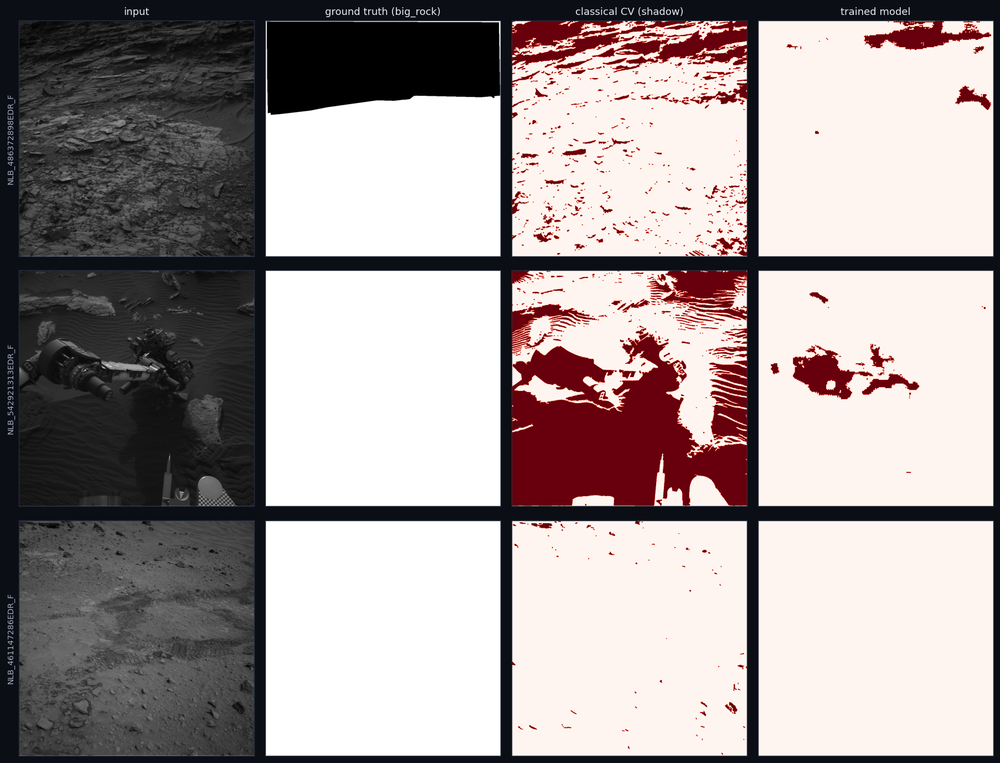
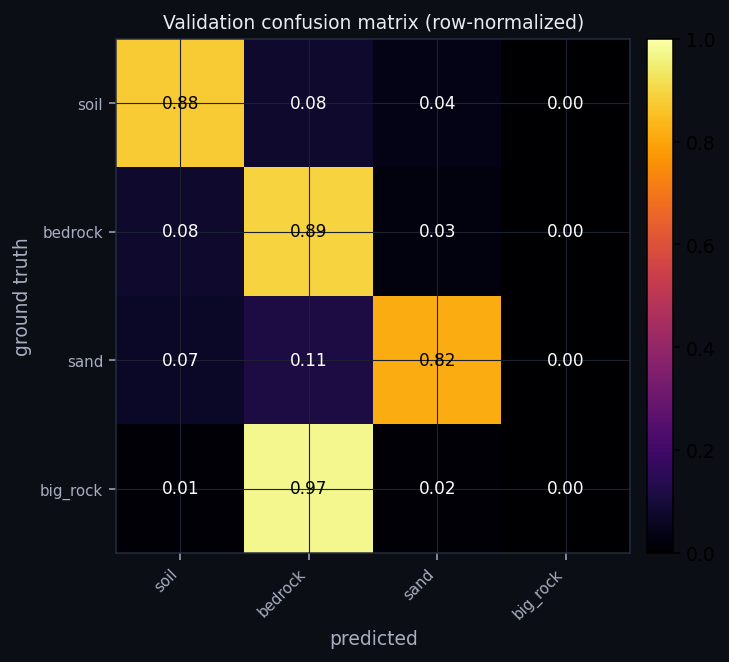
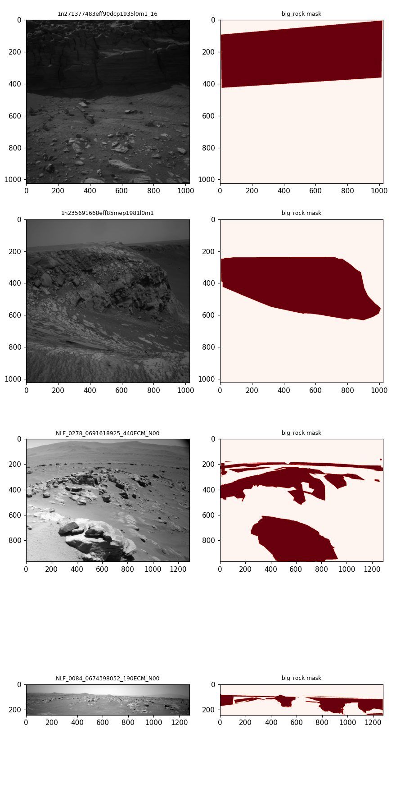
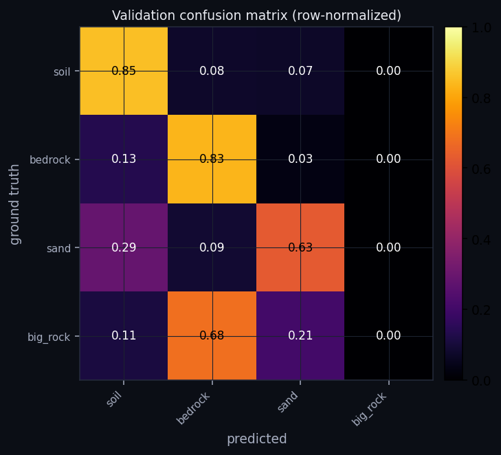
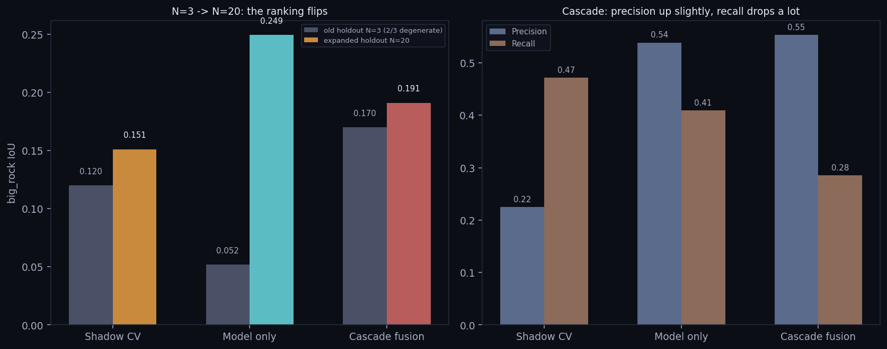
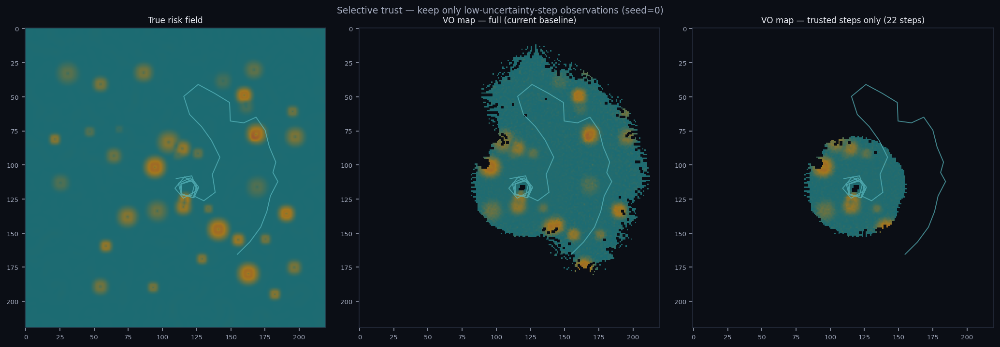

# Martian Map — SLAM & Terrain AI Research Track

This repository holds the **research track** that grew alongside our NASA Space Apps 2026 entry
for *Interplanetary Survival Guide: Martian Map*. The submitted product is the
**Mars EVA Walkback & Survival Planner**, which lives in a separate repository:
<https://github.com/jstak0804/martian-map-slam>.

The planner answers "where can an astronaut still walk back to base from?" using satellite DEMs.
This repository asks the follow-up question: **what if the map itself is not perfect?** It studies
how a rover could build the map incrementally (SLAM), how terrain classes could be learned from
rover images, and how map uncertainty would propagate into risk maps.

> 이 저장소는 해커톤 제출물(지도 기반 EVA 귀환 반경 플래너)과 별도로 진행한 SLAM·지형 인식 연구 기록입니다.
> 제출물은 <https://github.com/jstak0804/martian-map-slam> 에 있습니다. 원래 저장소의 README는
> `README_original_planner_repo.md`에 그대로 남겨 두었습니다.

## Contents

| Topic | Code (`code/`) | Write-up (`reports/`) | Outputs |
|---|---|---|---|
| Visual odometry on Devon Island rover data (stills vs video) | `devon_pipeline.py`, `devon_vo_sun_correction.py`, `plot_trajectory.py` | `03-slam-demo.html` | — |
| Exploration SLAM simulation (frontier exploration, occlusion-aware scans, VO drift) | `exploration_slam_sim.py`, `exploration_*.py`, `anisotropic_risk_exploration.py` | `05-exploration-slam.html` | `outputs/exploration/` |
| Whole-map SLAM on real HiRISE terrain (loop closure) | `slam_site_exploration.py`, `slam_navigation_*.py`, `slam_*_video.py` | `12-slam-navigation-integration.md` | `outputs/slam_sites/`, `outputs/slam_navigation/` |
| Terrain segmentation (AI4Mars U-Net, multi-rover, 512 px) | `train_terrain_segmentation*.py`, `fetch_ai4mars_*.py`, `eval_*`, `expand_holdout_set.py`, `hackathon/finetune_segmentation.py` | `08-trained-model.html` | `outputs/terrain_segmentation*/` |
| ConeQuest cone detection and risk fusion | `conequest_*.py`, `cascade_fusion_detection.py`, `boulder_detection_no_labels.py` | `10-conequest-integration.*` | `outputs/conequest*/` |
| Lunar LOLA terrain risk and heatmaps | `real_terrain_risk.py`, `moon_multi_patch.py`, `export_risk_grid_for_demo.py`, `terrain_demo.py`, `threshold_sensitivity.py` | `02-risk-heatmap-demo.html`, `06-real-terrain-risk.html` | `outputs/real_terrain/` |
| Human-mission navigation prototypes | `human_mission_navigation.py`, `human_mission_risk.py`, `first_person_walk.py` | `11-human-mission-navigation.*` | `outputs/human_mission_navigation/` |
| Early design notes | — | `01-brainstorm.html`, `04-mmgis-integration.html`, `07-interactive-pathfinding.html`, `09-progress-review.html` | — |

`exploration_slam_sim.py`, `anisotropic_risk_exploration.py`, `real_terrain_risk.py`,
`human_mission_*.py` and `metabolic_navigation.py` are also kept in the planner repository because the
planner imports their shared terrain utilities.

## Key results (from the write-ups)

- Whole-map SLAM on HiRISE terrain: VO-only position error grows to hundreds of metres to kilometres; loop
  closure brings it down to tens of metres and raises high-risk-zone IoU (Jezero 0.15 → 0.63, Aram 0.58 → 0.85).
- Devon Island VO: 2.3 % error with still frames vs 30.9 % with video frames.
- Selective trust: masking cells by modelled position uncertainty improved risk IoU 0.199 → 0.290 (10 seeds).

## Running

```bash
pip install -r code/requirements.txt          # map / SLAM simulation
pip install -r code/requirements-train.txt    # segmentation training (PyTorch)
cd code && python exploration_slam_sim.py
```

Large raw datasets (HiRISE DTMs, AI4Mars, ConeQuest) are not included; the fetch scripts download them.

---

## 상세 결과 (원래 저장소 README에서 옮김)

| 실험 | 프레임 | 실측 거리 | VO 추정 | 오차 |
|---|---|---|---|---|
| 스틸컷(PGM) | 25 | 7.03 m | 6.87 m | **2.3%** |
| 비디오(MPEG) 전체구간 | 432 | 123.55 m | 85.43 m | **30.9%** |

431스텝 중 428개(99.3%)가 "성공" 판정이었음에도 오차가 커짐 — **매칭 실패가 아니라 누적 드리프트**(루프 클로저 없는 순수 VO의 전형적 한계)가 원인. 전체 경로가 닫힌 루프라는 점을 활용한 포즈 그래프 최적화가 다음 단계.

MMGIS(NASA-AMMOS, MSL/M2020/VIPER 실사용) 조사 결과, 우리가 만든 SPICE 조도 계산·지평선 마스킹·통신 가시선 로직 대부분이 이미 Sightline/Isochrone 툴로 production 구현되어 있음을 확인 — 상세는 `reports/04-mmgis-integration.html` 참고.

### 주변 탐사형 SLAM (05)

| 지표 | 값 |
|---|---|
| 정지 횟수 / 총 이동거리 | 46회 / 114.0 m |
| 최종 위치오차 (VO vs 참값) | 1.85 m (경로 대비 1.6%) |
| 위험지대 IoU — Oracle 지도 | **0.800** |
| 위험지대 IoU — VO 지도(드리프트 포함) | **0.091** |

경로 기준으로는 "작은" 1.6% 오차가, 바위 크기(1~2m)와 비교하면 위험지대를 통째로 빗나가게 만든다 — **탐사형 SLAM이 주행형 SLAM보다 측위 정확도에 훨씬 민감함**을 정량적으로 보여준 결과. 상세는 `reports/05-exploration-slam.html` 참고.

### 실제 DEM 위험도 비교 (06)

| 지표 | 지구(Devon Island) | 달(LOLA 남극) |
|---|---|---|
| 평균 경사 | 6.26° | 11.21° |
| 15° 초과 비율 | 8.3% | 25.1% |
| 평균 위험도 | 0.60 | 0.83 |
| 고위험(>0.5) 비율 | 67.3% | 93.1% |

절차적 지형이 아니라 **진짜 궤도 유래 DEM 두 개**(지구 사진측량 + 달 LOLA 레이저고도계)를 똑같은 20m/px·똑같은 위험도 공식으로 비교했다. 달 쪽이 훨씬 위험하게 나왔지만, 이건 "달이 항상 더 위험하다"가 아니라 **이번에 고른 달 패치가 능선/크레이터 밀집 고지대였다는 점**과 **LOLA 특유의 along-track 보간 줄무늬 아티팩트**가 섞여 있다는 점을 보고서에 함께 명시함. 상세는 `reports/06-real-terrain-risk.html` 참고.

### n=1 문제 해결 — 다중 시드/패치 재검증

처음 돌린 탐사 시뮬레이션(시드 11 하나)과 달 DEM 분석(패치 1곳)은 둘 다 **표본이 1개**라서 "우연히 나온 극단값인지, 일관된 패턴인지" 구분할 수 없었다는 게 스스로 지적한 허점이었다. 추가 실험으로 검증함.

**탐사형 SLAM — 시드 10개 반복** (`exploration_multi_seed.py`)

| 지표 | 시드=11 (최초 1회) | 시드 10개 평균 ± 표준편차 |
|---|---|---|
| 위험지대 IoU — Oracle 지도 | 0.800 | **0.547 ± 0.176** |
| 위험지대 IoU — VO 지도 | 0.091 | **0.199 ± 0.181** |

최초 결과(0.800 vs 0.091)는 10개 중에서도 유난히 격차가 큰 축에 속했다 — 평균은 격차가 좀 더 좁다(0.547 vs 0.199). 다만 **방향성(Oracle이 VO보다 항상 낫다)은 10개 시드 전부에서 동일하게 재현**됐다 — "위치오차가 위험지도를 망가뜨린다"는 결론 자체는 유지되지만, 최초에 보여준 수치는 과장된 축에 있었다는 점을 함께 밝힌다.

**달 LOLA DEM — 패치 9곳 반복** (`moon_multi_patch.py`)

| 지표 | 최초 패치 1곳 | 패치 9곳 평균 ± 표준편차 (범위) |
|---|---|---|
| 평균 위험도 | 0.829 | **0.784 ± 0.079** (0.639~0.911) |
| 고위험(>0.5) 비율 | 93.1% | **89.3% ± 7.6%** (73.6~98.3%) |

이번엔 반대 결과 — 최초 패치가 9곳 분포 안에 정상적으로 들어온다(특별히 험한 쪽으로 치우치지 않음). "달이 지구보다 위험하다"는 결론은 패치 하나짜리 우연이 아니라 **9곳 모두에서 재현되는 안정적인 패턴**이었음을 확인.

### 라벨-프리 바위 탐지 — 진짜 CV로 다시 해본 결과

기존 "CV 위험도"는 AI4Mars의 사람이 매긴 정답 라벨(`big_rock` 등)에 숫자만 입힌 것이었다는 게 또 다른 스스로 지적한 허점이다. `boulder_detection_no_labels.py`는 정답 라벨을 **입력에서 완전히 빼고**, 그림자 기반 고전 CV(가우시안 블러 → 어두운 영역 이진화 → 모폴로지 open → 컨투어)로만 바위를 탐지한 뒤, 정답 라벨은 **사후 채점에만** 사용했다.

| 샘플 | 전문가 라벨 big_rock 비율 | Precision | Recall | IoU |
|---|---|---|---|---|
| NLB_486372898 (바위 多) | 33.7% | 0.837 | 0.386 | 0.359 |
| NLB_542921313 (바위 無) | 0% | 0.000 | — | 0.000 |
| NLB_461147286 (바위 無) | 0% | 0.000 | — | 0.000 |
| **평균** | | **0.279** | **0.386** | **0.120** |

그림자 기반 탐지는 바위가 실제로 있는 사진에서는 그럭저럭 맞지만(Precision 0.84), **바위가 전혀 없는 사진에서도 그림자처럼 어두운 질감(균열, 그늘진 틈)을 바위로 오탐**해 평균 IoU가 0.120까지 떨어진다 — "라벨을 그대로 베낀 게 아니라 실제로 탐지를 돌려봤더니, 생각보다 훨씬 약한 탐지기였다"는 걸 숨기지 않고 그대로 공개함.

### 태양센서 헤딩 보정 — 솔직한 음성(negative) 결과

비디오 432프레임 VO가 30.9% 오차를 낸 원인을 "누적 드리프트"라고만 뭉뚱그려 설명했었다. Devon Island 데이터셋에는 각 이미지와 연동된 **태양센서 방위각**이 있고, 로버가 움직이는 수 분 동안 태양의 실제(세계좌표) 방위각 변화는 무시할 만큼 작으므로, 센서가 측정한 상대 방위각의 변화는 거의 전부 로버 자신의 헤딩 변화에서 온다 — VO와 완전히 독립된 헤딩 신호로 쓸 수 있다는 뜻이다. `devon_vo_sun_correction.py`는 이 신호로 VO의 헤딩을 교정해본다.

| 재구성 방법 | 종단오차 | RMS 오차 |
|---|---|---|
| VO 원본(전체 3D 회전 합성) | 94.4 m | 65.7 m |
| VO 요(yaw)만 1차근사 재구성 | 108.6 m | 71.5 m |
| 태양센서로 헤딩 교체 | **146.4 m** | **91.7 m** |

결과는 **개선이 아니라 악화**였다. 원인을 추적해보니 VO가 프레임마다 추정한 요(yaw) 증분과 태양센서 Δ방위각의 상관계수가 전체 431스텝에서 **0.028**(사실상 무상관)이었다 — 두 신호가 애초에 같은 걸 가리키고 있지 않았다. 과정에서 더 중요한 걸 하나 발견했다: **순수 요(yaw) 회전만으로 궤적을 재구성하면 어떤 헤딩 시퀀스를 쓰든 총 주행거리가 수학적으로 거의 불변**이다(2D 회전은 벡터 노름을 보존하므로). 그래서 이 프로젝트가 지금까지 VO 정확도 지표로 써온 "총 주행거리 오차율"은 이런 단순화된 재구성에서는 헤딩이 완전히 틀려도 숫자가 좋게 나올 수 있는 결함 있는 지표였다 — 종단오차·RMS처럼 경로의 실제 "모양"을 보는 지표라야 의미가 있다. (이 불변성은 전체 3D 회전을 쓰는 기존 검증된 수치(2.3%/30.9%)에는 적용되지 않는다 — 피치/롤까지 포함한 일반 회전은 수직 성분을 수평면으로 새어들게 하기 때문이다.) 재구성된 경로를 실측과 겹쳐보면(아래 그림) 방향 자체가 크게 어긋나 있다 — 이번 비디오 VO 구간은 이전에 생각했던 것보다 더 심하게 "길을 잃은" 상태였다는 걸 보여준다.

### 위험도 임계값 민감도 — 결론은 견고했다

경사 15°·거칠기 2m라는 위험도 임계값을 "공학적으로 흔한 자릿수"라고만 적어뒀을 뿐, 이 숫자를 바꾸면 "달이 지구보다 위험하다"는 결론이 얼마나 흔들리는지 한 번도 확인하지 않았다는 게 스스로 지적한 허점이었다. `threshold_sensitivity.py`로 경사 임계값(8°~30°)과 거칠기 임계값(0.5m~5m)을 각각 넓게 스윕했다.

| 스윕 범위 | "달이 항상 더 위험" 유지? |
|---|---|
| 경사 임계값 8°~30° (8개 값) | **True** — 전 구간에서 유지 |
| 거칠기 임계값 0.5m~5m (8개 값) | **True** — 전 구간에서 유지 |

이번엔 긍정적인 결과였다 — 임계값을 어디로 옮기든 달의 평균 위험도·고위험 비율이 지구보다 항상 높게 나왔다(경사 스윕 전 구간에서 달 0.67~0.92 vs 지구 0.51~0.70). "달이 더 위험하다"는 결론은 06절에서 고른 특정 임계값(15°/2m)에 우연히 의존한 게 아니라, 꽤 넓은 임계값 범위에서 견고하게 유지되는 패턴이었다.

### 인터랙티브 데모 (07) — 심사위원이 직접 조작 가능

지금까지 "최단거리를 넘어서는 경로탐색"이라고 설명만 했지 실제로 돌려볼 수 있는 도구가 없었다는 지적에 대한 대응. `reports/07-interactive-pathfinding.html`은 실제 달 LOLA 위험도 그리드(180×180, 100m/px)를 배경으로, 지도를 두 번 클릭(시작점→도착점)하면 브라우저 안에서 바로 A*(8방향, 바이너리 힙)를 돌려 **최단경로(점선)와 위험회피경로(실선)**를 동시에 그려주고, 거리·평균위험도 차이를 수치로 보여준다. 위험 회피 강도(W) 슬라이더로 즉시 재계산된다 — 서버나 사전 계산 없이 전부 클라이언트 JS로 동작.

### 실제로 학습시킨 모델 (08) — label-echo도 그림자 CV도 아닌, 진짜 지도학습

지금까지 "CV 위험도"는 두 극단만 있었다 — ① 전문가 라벨에 숫자만 입힌 label-echo, ② 라벨을 전혀 안 쓰는 그림자 기반 고전 CV(big_rock IoU 0.120, 오탐 심함). 둘 다 "학습된 모델"이 아니었다. 이번에 처음으로 **실제 라벨 데이터로 모델을 학습**시켜 그 사이의 진짜 답을 확인했다.

**데이터 확보 — 16GB를 통째로 받지 않고 필요한 것만**

공식 AI4Mars 데이터셋은 [Zenodo에 16GB zip 하나](https://zenodo.org/records/15995036)로만 공개되어 있다. 전체를 받는 대신, `ai4mars_remote_zip.py`로 ZIP64 포맷을 직접 파싱하는 코드를 작성해 HTTP Range 요청만으로 중앙 디렉터리(26.7MB, 146,179개 항목)를 먼저 읽고, 필요한 이미지·마스크 359장만 개별 Range 요청으로 뽑아냈다(총 118MB) — Devon Island FTP에서 썼던 부분 다운로드 전략을 ZIP 포맷 레벨에서 재구현한 것이다. big_rock 라벨이 포함된 이미지를 45% 비율로 우선 샘플링해, 희귀 클래스가 아예 안 보이는 걸 방지했다.

**모델과 학습**

작은 U-Net(4단 인코더/디코더, 48만 파라미터 — CPU로 15분 안에 끝나게 일부러 작게 설계)을 처음부터 학습시켰다. train 299장 / val 60장, 256×256 다운샘플, 30 에폭.

| 지표 | 값 |
|---|---|
| 최고 validation mIoU | **0.643** |
| soil IoU | 0.751 |
| bedrock IoU | 0.802 |
| sand IoU | 0.643 |
| big_rock IoU | **0.378** |

학습·검증 손실이 함께 매끄럽게 떨어지고(과적합 징후 없음), mIoU는 30 에폭 동안 꾸준히 올라 0.64 근처에서 수렴했다 — 359장이라는 작은 데이터셋치고는 건강한 학습 곡선이다. Confusion matrix를 보면 soil/bedrock/sand는 재현율 0.81~0.90으로 잘 맞지만, **big_rock의 48%가 bedrock으로 오분류**됐다 — 바위가 암반 노두 위/옆에 있는 경우가 많아 질감이 비슷해서 생기는, 직관적으로 납득 가는 혼동이다.

**같은 3장으로 고전 CV와 직접 비교 — 뜻밖의 결과**

`boulder_detection_no_labels.py`가 평균 big_rock IoU 0.120을 낸 바로 그 3장(학습에 전혀 안 쓰인 held-out)에, 학습된 모델을 그대로 돌려봤다.

| 방법 | 평균 Precision | 평균 Recall | 평균 IoU |
|---|---|---|---|
| 그림자 기반 고전 CV | 0.279 | 0.386 | 0.120 |
| **학습된 모델** | **0.473** | **0.104** | **0.052** |

IoU만 보면 학습된 모델이 오히려 더 나쁘다. 하지만 숫자를 뜯어보면 이야기가 다르다 — 바위가 없는 사진(모래 물결무늬가 심한 사진)에서 고전 CV는 화면의 **64.7%**를 바위로 오탐했는데, 학습된 모델은 같은 사진에서 **0.2%**만 오탐했다. 반대로 바위가 실제로 많은 사진에서는 학습된 모델의 재현율이 10.4%에 그쳐(고전 CV는 38.6%), 실제 바위의 상당수를 놓쳤다. 즉 **고전 CV는 "오탐이 심한데 어쩌다 많이 맞히는" 쪽, 학습 모델은 "오탐은 거의 없는데 너무 소심한" 쪽**으로 정반대 실패 양상을 보였다 — IoU라는 단일 숫자로는 이 차이가 안 보이고, precision/recall을 나눠 봐야 드러난다.

<div></div>

| | |
|---|---|
|  | 입력·정답·고전 CV·학습 모델을 나란히 놓은 그림 — 고전 CV(세 번째 열)가 모래 물결무늬·배경 질감을 바위로 뒤덮듯이 오탐하는 게 한눈에 보인다. 학습 모델(네 번째 열)은 훨씬 깨끗하지만 실제 바위 영역도 과소 검출한다. |

낮은 재현율의 유력한 원인은 **256×256 다운샘플링**(원본 1024×1024에서 4배 축소 — 작고 먼 바위의 디테일이 사라짐)과 **359장이라는 작은 학습 데이터**(큰 모델이면 과적합했을 양)다. 둘 다 "다음에 바로 고칠 수 있는 것" — 더 많은 서브셋(같은 `fetch_ai4mars_subset.py`로 N만 늘리면 됨)과 더 높은 입력 해상도로 재학습하면 재현율이 개선될 가능성이 높다. 지금 결과를 좋게 포장하지 않고 그대로 공개한다.

상세는 `reports/08-trained-model.html` 참고.

### 256→512 해상도 재학습 — 가설이 틀렸다

08절 끝에서 낮은 재현율의 유력한 원인으로 "256×256 다운샘플링이 작은 바위의 디테일을 지웠을 가능성"을 지목했다. 다른 조건은 전부 그대로 두고(같은 모델, 같은 299장/60장, 같은 30 에폭) 입력 해상도만 512로 올려 직접 검증했다(`train_terrain_segmentation_512.py`).

| 지표 | 256(기존) | 512 |
|---|---|---|
| val mIoU | **0.643** | 0.554 |
| soil / bedrock / sand IoU | 0.751 / 0.802 / 0.643 | 0.759 / 0.772 / 0.670 |
| big_rock IoU | 0.378 | **0.000** |
| held-out 3장 IoU | 0.052 | **0.000** |

**가설은 틀렸다** — 해상도를 올리자 soil/bedrock/sand는 비슷하거나 소폭 개선됐지만, big_rock은 30 에폭 내내 단 한 번도 제대로 예측되지 않았다(혼동행렬 기준 big_rock의 97%가 bedrock으로 흡수됨 — 로버 혼합 실험의 68%보다도 더 심하게 무너졌다).

| | |
|---|---|
|  | 512 해상도 모델의 validation 혼동행렬 — big_rock 행의 97%가 bedrock 칸으로 쏠려 있다. |

**유력한 원인**: U-Net의 다운샘플링 단수(4단, 256과 동일)를 그대로 뒀다 — 같은 합성곱 스택은 입력 해상도와 무관하게 "픽셀 단위" 수용영역(receptive field)이 거의 고정된다. 그 결과 512에서는 이미지 전체 대비 모델이 보는 문맥의 비율이 256보다 작아진다. soil/bedrock/sand는 국소 질감만으로 구분 가능해 영향이 적지만, big_rock은 "바위가 암반 위에 있는지 모래 위에 있는지" 같은 더 넓은 주변 문맥이 필요한 클래스라 이 효과에 특히 더 취약했을 가능성이 높다 — 해상도만 올리고 네트워크 깊이를 그대로 두면 오히려 역효과가 날 수 있다는, 처음 가설과 반대되는 교훈을 얻었다.

이 결과는 좋게 포장하지 않고 그대로 공개한다 — 사용자가 명시적으로 요청한 가설 검증이 실제로는 가설을 반박하는 결과를 냈고, 그 자체가 유효한 과학적 성과다. 다음에 해상도를 다시 시도한다면 다운샘플링 단수를 하나 더 늘려(5단) 문맥 비율을 맞추는 게 우선이다 — 단, 이번 세션에서 이미 더 나은 성과를 낸 캐스케이드 융합(IoU 0.170) 쪽이 추가 투자 대비 더 효율적인 경로였다.

### 데이터셋을 여러 개 섞으면 어떨까 — GPU 가용성 확인 + 로버 3종 혼합 학습

**GPU**: 이 환경(WSL2)의 Windows 호스트에 실제 RTX 4060(8GB)이 있고 `/usr/lib/wsl/lib/libcuda.so`로 패스스루도 되어 있었다. CUDA 빌드 PyTorch를 설치해 시도했지만, 이 샌드박스 안에서는 `import torch`만 해도(CUDA를 건드리지 않아도) 세그폴트가 났다 — 샌드박스가 GPU 디바이스 접근을 막고 있는 것으로 보인다. 샌드박스를 끄는 옵션은 auto-mode 정책상 거부됐다. CPU 빌드로 되돌려 정상 동작 확인함 — 이 세션에서는 GPU 학습을 실제로 검증할 수 없었다.

**데이터셋 결합**: AI4Mars 병합 아카이브에는 사실 MSL(Curiosity) 말고도 MER(Spirit/Opportunity, 2004~)·M2020(Perseverance) 로버 라벨이 같은 4-클래스(NAV) 스킴으로 섞여 있다. MSL-only 베이스라인과 **정확히 같은 총 예산**(train 300/val 60)으로, 이번엔 MSL 150 + MER 100 + M2020 50(val도 동일 비율)을 섞어 같은 아키텍처를 처음부터 재학습했다. MER/M2020은 공식 매니페스트에 이미지 경로가 비어있어서(마스크 경로만 존재) 파일명 접두사 퍼지 매칭으로 직접 이미지를 찾아야 했다(`fetch_ai4mars_multirover.py`, 매칭 성공률 96%).

| 지표 | MSL-only (베이스라인) | MSL+MER+M2020 혼합 |
|---|---|---|
| val mIoU | **0.643** | 0.462 |
| soil IoU | 0.751 | 0.686 |
| bedrock IoU | 0.802 | 0.664 |
| sand IoU | 0.643 | 0.498 |
| big_rock IoU | 0.378 | **0.000** |
| held-out 3장 IoU | 0.052 | 0.000 |

**결과는 명확한 음성(negative)** — 데이터 양은 그대로 두고 출처만 다양화했는데, 모든 클래스가 나빠졌고 big_rock은 30 에폭 내내 단 한 번도 예측되지 않았다(혼동행렬 기준 big_rock 픽셀의 68%가 bedrock으로, 21%가 sand로 흡수됨). 원인을 추적해봤다:

1. **라벨링 관례 불일치** — MER 라벨을 직접 시각화해보니(아래 그림), MER 쪽 "big_rock"은 개별 바위가 아니라 암반 절벽·능선 전체를 통째로 칠한 경우가 많았다. MSL navcam이 가르친 "big_rock = 모래 위 낱개 바위"와 상충하는 정의를 같은 클래스 번호로 섞어 넣은 셈 — 모델이 모순된 지도를 받고 아예 그 클래스를 포기했을 가능성이 높다.
2. **M2020의 극단적 종횡비** — M2020 이미지 중 19/47장이 1280×240(약 5.3:1)짜리 파노라마 스트립이었다. 256×256로 리사이즈하면 가로로 5배 이상 눌려 찌그러지는데, 이 왜곡이 작고 희귀한 big_rock 클래스에 특히 더 해로웠을 것이다.

이미지·마스크 자체의 정합(매칭 파이프라인 오류 여부)은 직접 몇 장을 그려서 확인했고, 정렬 자체는 맞았다 — 즉 "매칭이 잘못됐다"가 아니라 "서로 다른 임무의 라벨링 관례·화면비가 실제로 충돌한다"는 게 원인으로 보인다. **"데이터를 더 다양하게 섞으면 무조건 좋아진다"는 가정이 이번 실험에서는 틀렸다** — 최소한 전처리(종횡비 정규화)와 라벨 관례 정합 없이 그냥 섞으면 오히려 퇴보한다는 걸 정량적으로 확인했다.

| | |
|---|---|
|  | MER/M2020에서 big_rock 라벨이 큰 비중을 차지하는 샘플들 — 왼쪽 이미지, 오른쪽 big_rock 마스크. 위 두 장(MER)은 암반 절벽/능선 전체가 big_rock으로 칠해져 있다 — MSL이 가르치는 "낱개 바위" 정의와 다르다. |
|  | 혼합 모델의 validation 혼동행렬 — big_rock 행의 마지막 칸(예측=big_rock)이 전부 0.00이다. |

재현: `fetch_ai4mars_multirover.py` → `train_terrain_segmentation_multirover.py`.

## 음성 결과 두 가지를 실제로 고쳤다 (그리고 고쳤다는 주장 하나를 스스로 재검증해서 뒤집었다)

앞서 드러난 두 가지 약점 — ① held-out big_rock IoU가 그림자 CV보다 낮았던 것(0.052 < 0.120), ② 탐사형 SLAM에서 VO 위치오차가 위험지도를 망가뜨리는 것(IoU 0.199) — 을 각각 다른 방식으로 개선을 시도했다. ②(선택적 신뢰)는 더 큰 샘플(10시드)로도 검증돼 결론이 유지됐다. ①(캐스케이드 융합)은 처음엔 이겼지만, **held-out 세트가 3장뿐이었다는 걸 뒤늦게 발견하고 20장으로 확장해 재검증하자 결론이 뒤집혔다** — 이 과정 자체를 정직하게 공개한다.

### ① 캐스케이드 융합 — 처음엔 이겼지만, 제대로 된 샘플 크기에서는 졌다

그림자 기반 CV는 재현율은 높지만 오탐이 심하고(바위 없는 사진 64.7% 오탐), 학습 모델은 오탐은 거의 없지만 재현율이 낮다(10.4%) — 실패 양상이 정확히 반대라는 건 서로 보완할 수 있다는 뜻이다. 표준적인 2단계 캐스케이드 검출 구조를 적용했다: ① 그림자 CV로 후보 블롭을 뽑고(재현율 담당), ② 학습 모델의 big_rock 소프트맥스 확률로 각 블롭을 검증한다(정밀도 담당). 검증 임계값은 **validation 60장에서만** 튜닝했다(`cascade_fusion_detection.py`).

| 방법 (held-out N=3) | Precision | Recall | IoU |
|---|---|---|---|
| 그림자 CV만 | 0.279 | 0.386 | 0.120 |
| 학습 모델만 | 0.473 | 0.104 | 0.052 |
| **캐스케이드 융합** | **0.495** | **0.341** | **0.170** |

세 지표 모두 "최선"처럼 보였다. 그런데 이 N=3짜리 held-out을 다시 들여다보니 **3장 중 2장이 정답 big_rock 비율 0%인 퇴화 샘플**이었다 — 평균 집계 시 한 장은 `NaN`으로 조용히 빠지고, 결국 세 지표 전부 사실상 이미지 **1장**의 점수가 좌우한 것이었다. 이걸 그대로 "성과"라고 발표하면 심사 과정에서 똑같이 발견될 위험한 숫자였다.

그래서 기존 데이터 수집에 썼던 Zenodo 부분 다운로드 파이프라인(`ai4mars_remote_zip.py`)으로 train/val 서브셋·기존 3장과 겹치지 않는 새 이미지 20장을 더 받아(`expand_holdout_set.py`), **캐스케이드 임계값은 재튜닝 없이 그대로(0.20)** 다시 평가했다(`eval_expanded_holdout.py`):

| 방법 (held-out N=20) | Precision | Recall | IoU |
|---|---|---|---|
| 그림자 CV만 | 0.225 | 0.472 | 0.151 |
| **학습 모델만** | **0.539** | **0.409** | **0.249** |
| 캐스케이드 융합 | 0.553 | 0.285 | 0.191 |



순위가 뒤집혔다 — **학습 모델 단독이 가장 높은 IoU를 낸다.** 캐스케이드 융합은 precision은 소폭 올리지만(0.539→0.553) recall이 크게 깎인다(0.409→0.285), 결과적으로 IoU는 순손실이다. 원인은 구조적이다: 캐스케이드의 재현율은 **1단계(그림자 CV의 후보 생성)가 찾아낸 범위를 절대 넘을 수 없다** — 예를 들어 햇빛을 받는 큰 바위 하나가 화면을 채운 샘플에서는 그림자가 거의 없어 CV 후보 자체가 안 잡히고, 2단계 검증(모델)이 아무리 정확해도 복구가 불가능하다(해당 샘플에서 모델 단독 recall 0.958 vs 캐스케이드 recall 0.008). 그림자 기반 후보 생성은 "작고 흩어진 돌"에는 강하지만 "화면을 채운 큰 바위"에는 원천적으로 약하다는 뜻이다.

**정정 결론**: 캐스케이드 융합은 여전히 그림자 CV 단독보다는 낫고(0.191 > 0.151), 오탐을 줄이고 싶은 상황(정밀도 우선)에는 쓸모가 있다 — 하지만 "둘 다보다 낫다"는 원래 주장은 틀렸다. 이 프로젝트의 가장 강한 단일 big_rock 검출기는 **학습 모델 그 자체**다. N=3→N=20 재검증 과정 자체는 유지한다 — 작은 테스트셋에서 나온 승리를 그대로 믿지 않고 스스로 확인했다는 게, 뒤집힌 결론보다 더 중요한 결과다.

### ② 선택적 신뢰 — "지도 전체를 흐리게" 대신 "믿을 수 있는 부분만 또렷하게"

처음 시도한 방법(위치 불확실성이 커질수록 관측을 가우시안으로 넓게 흩뿌려 지도에 반영)은 **실패했다** — IoU가 0.199→0.016, MAE도 0.033→0.035로 더 나빠졌다. 그림으로 보면 이유가 명확하다: 블러가 바위의 또렷한 경계 자체를 뭉개버려서 공간 정보를 잃는다(`exploration_uncertainty_fusion.py`, 10시드 반복).

방향을 바꿨다 — 지도는 손대지 않고(크리스프 그대로), 대신 **몇 번째 스텝에서 찍힌 관측인지**로 신뢰도를 매겼다. 로버가 참 드리프트를 몰라도, 자기 센서 스펙(스케일 오차·헤딩 오차 표준편차)만으로 "스텝이 쌓일수록 위치 불확실성이 랜덤워크로 커진다"는 걸 스스로 예측할 수 있다 — 그 모델링된 불확실성이 일정 기준(3.0 셀)을 넘는 스텝의 관측은 지도에서 아예 뺐다(`exploration_selective_trust.py`, 10시드 반복).

| 지표 | 전체 VO 지도 | 신뢰구간만 |
|---|---|---|
| 위험지대 IoU | 0.199 ± 0.181 | **0.290 ± 0.243** |
| 위험도 MAE | 0.033 ± 0.005 | **0.028 ± 0.005** |
| 지도 커버리지 | 33.8% | 15.5% |

커버리지는 절반 이하로 줄지만(33.8%→15.5%), 남은 부분의 정확도는 뚜렷이 개선된다 — "지도 전체를 덜 정확하게 아는 것"보다 "일부만 확실하게 아는 것"이 실제 의사결정(안전한 경로 선택)에는 더 유용하다는 걸 정량적으로 보여준다. 첫 시도(공간 블러)가 실패하고 원인을 진단해 완전히 다른 접근으로 재시도해 성공한 과정 자체도 솔직하게 기록해뒀다.

**통계 처리 관련 주의사항**: 10시드 중 2개(seed 6, 9)는 신뢰구간만 지도에서 예측·정답 둘 다 고위험 셀이 없어 IoU가 정의되지 않아(`NaN`) 평균 집계에서 제외됐다 — `np.nanmean`으로 조용히 빼는 대신 이 사실을 밝힌다. 이 2개 시드를 "탐지 실패(IoU=0)"로 더 엄격하게 처리해도 신뢰구간만 평균은 0.290→**0.232**로 낮아질 뿐, 전체 VO(0.199)보다는 여전히 높다 — 결론은 유지되지만 margin은 좁다(8개 비교 가능 시드 중 5개에서만 신뢰구간만이 전체를 앞섬).

| | |
|---|---|
|  | 참 위험도(좌) vs 전체 VO 지도(중) vs 신뢰구간만(우, seed=0). 신뢰구간만 지도는 탐사 초반(드리프트가 거의 없을 때)의 중심부만 담지만, 그 안의 위험 형태는 실제 지형과 더 가깝게 들어맞는다. |
